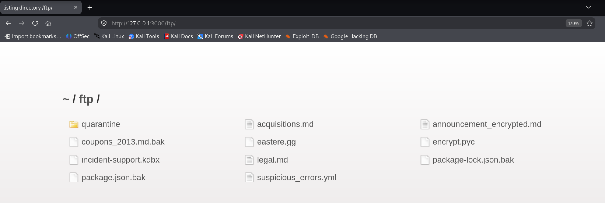
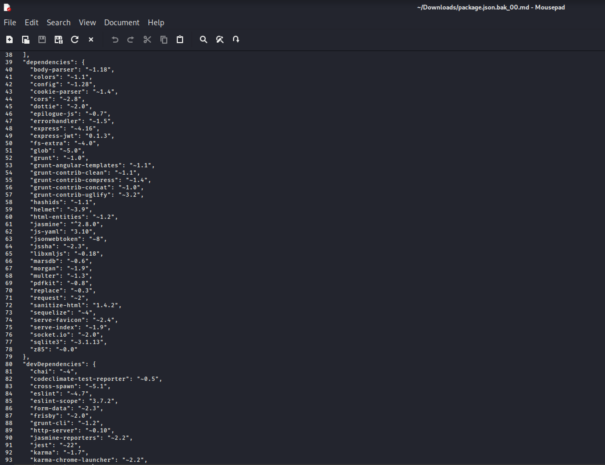

# Forgotten Developer Backup

A 4-star **Sensitive Data Exposure** challenge in the OWASP Juice Shop. A developer
backup file (`package.json.bak`) was left in a publicly served folder. The server
only allows `.md` and `.pdf` downloads, so the backup is retrieved by bypassing the
extension filter with a **Poison Null Byte**.

:::warning Educational purpose only
This documentation was produced for training during a DevSecOps course. All
attacks were performed against a local OWASP Juice Shop instance in a personal
VM. Never apply these techniques to systems you are not authorized to test.
:::

## Table of Contents

- [Overview](#overview)
- [The Vulnerability](#the-vulnerability)
- [Reconnaissance](#reconnaissance)
- [Exploitation](#exploitation)
- [Impact](#impact)
- [Mitigation](#mitigation)
- [References](#references)

## Overview

| Property | Value |
| --- | --- |
| Challenge | Forgotten Developer Backup |
| Category | Sensitive Data Exposure |
| Difficulty | ⭐⭐⭐⭐ |
| Technique | Poison Null Byte (file-extension filter bypass) |
| Video | [Watch on Loom](https://www.loom.com/share/089f169cccdb4e02bf902a2971c3dadb) |

## The Vulnerability

The Juice Shop serves files directly from a public `/ftp` folder. Two problems
combine here:

1. The folder exposes a **directory listing**, so every file in it can be seen,
   including files that were never meant to be public.
2. Downloads are restricted to `.md` and `.pdf` by a filter that only checks the
   **end of the file name** as a string. This string check can be fooled with a
   **null byte**, letting any file be downloaded.

## Reconnaissance

1. **Find the folder.** Documents in the app (for example the Terms of Use) are
   served from a path like `http://127.0.0.1:3000/ftp/legal.md`. The `/ftp`
   segment points to a public file folder.
2. **List its contents.** Opening the folder itself shows a directory listing:

   ```
   http://127.0.0.1:3000/ftp/
   ```

   Among the legitimate `.md`/`.pdf` documents there are files that clearly do
   not belong in a public folder, including `package.json.bak` — a backup of the
   project's Node.js manifest and the target for this challenge.



## Exploitation

**1. Try the direct download.** Requesting the backup like a normal file is
blocked by the extension filter:

```
http://127.0.0.1:3000/ftp/package.json.bak
```

```
403 Error: Only .md and .pdf files are allowed!
   at verify (/juice-shop/build/routes/fileServer.js:68:18)
```

The verbose error even leaks the server's source path and the name of the check
(`verify`).

**2. Add a raw null byte.** Appending an encoded null byte followed by `.md`
should make the filter see a `.md` ending. A single-encoded null byte is rejected
by an outer layer before it reaches the filter:

```
http://127.0.0.1:3000/ftp/package.json.bak%00.md
```

```
400 BadRequestError: Bad Request
```

**3. Double-encode the null byte.** The request is decoded more than once on its
way through the server. Encoding the percent sign itself (`%` → `%25`) hides the
null byte from the outer layer: the first decode turns `%2500` into the text
`%00`, and a deeper layer decodes that into the actual null byte:

```
http://127.0.0.1:3000/ftp/package.json.bak%2500.md
```

The file now downloads successfully. The challenge is marked as solved.



**Why this works.** The filter is written in JavaScript, where a null byte
(`\0`) is just an ordinary character, so it sees the full name
`package.json.bak␀.md`, which ends in `.md`, and allows it. The underlying file
system is accessed through C, where `\0` means "end of string", so it stops early
and opens `package.json.bak`. The two layers disagree about where the name ends,
and that gap is the vulnerability. This is known as a **Poison Null Byte**.

## Impact

A `package.json` lists a project's dependencies and their exact versions, its
scripts, and metadata. Exposing a backup of it lets an attacker:

- **Map the dependencies and versions** and then look up publicly known
  vulnerabilities (CVEs) for those exact versions — a ready-made list of possible
  entry points.
- **Learn internal scripts and tooling** defined in the file, which hints at how
  the application is built and run.

More generally, a reachable backup file is a direct information leak. The same
technique would work on other forgotten files in the folder (configuration,
source, database dumps), which could expose far more sensitive data.

## Mitigation

The root cause is not only the null byte — it is a chain of weak decisions:

- **Do not store sensitive or backup files in a web-served directory.** The backup
  should never have been reachable over HTTP in the first place.
- **Disable directory listing**, so the folder's contents are not advertised.
- **Do not rely on a string check of the file extension.** Validate and normalize
  the full resolved path, and reject any request containing a null byte or path
  traversal (`..`). Prefer an allowlist of known files over suffix matching.
- **Do not expose stack traces or source paths** in error responses.
- **Keep dependencies up to date**, so that a leaked version list is less useful
  to an attacker.

## References

- [OWASP — Sensitive Data Exposure](https://owasp.org/www-project-top-ten/2017/A3_2017-Sensitive_Data_Exposure)
- [OWASP — Embedding Null Code](https://owasp.org/www-community/attacks/Embedding_Null_Code)
- [CWE-158 — Improper Neutralization of Null Byte or NUL Character](https://cwe.mitre.org/data/definitions/158.html)
