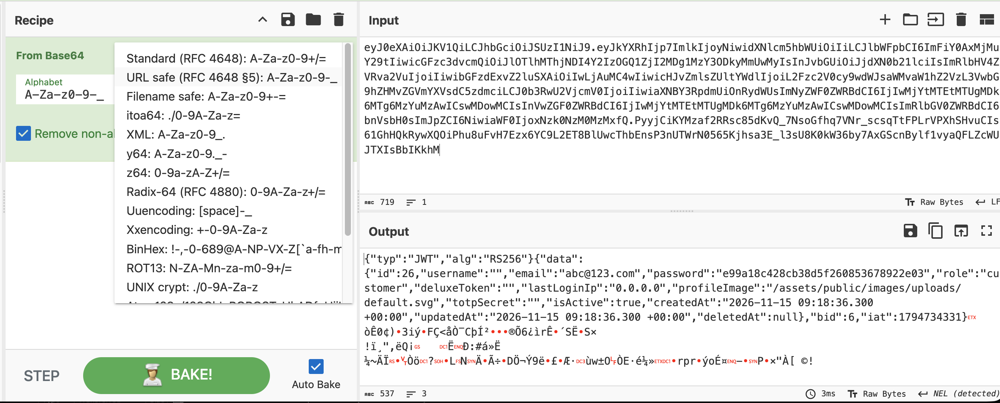
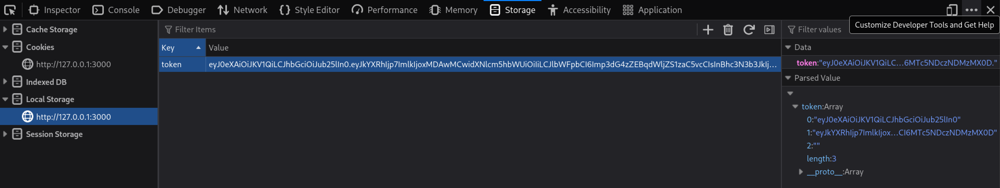

# Unsigned JWT

A 5-star **Broken Authentication** challenge in the OWASP Juice Shop. The goal is
to forge a JSON Web Token (JWT) that impersonates the non-existing user
`jwtn3d@juice-sh.op`. Because the server does not restrict which signature
algorithm it accepts, a token whose header declares `alg: none` is treated as
valid **without any signature** — so the entire payload can be rewritten at will.

:::warning Educational purpose only
This documentation was produced for training during a DevSecOps course. All
attacks were performed against a local OWASP Juice Shop instance in a personal
VM. Never apply these techniques to systems you are not authorized to test.
:::

## Table of Contents

- [Overview](#overview)
- [The Vulnerability](#the-vulnerability)
- [Reconnaissance](#reconnaissance)
- [Exploitation](#exploitation)
- [Impact](#impact)
- [Mitigation](#mitigation)
- [References](#references)

## Overview

| Property | Value |
| --- | --- |
| Challenge | Unsigned JWT |
| Category | Broken Authentication |
| Difficulty | ⭐⭐⭐⭐⭐ |
| Technique | `alg: none` signature-bypass (JWT forgery) |
| Video | _[add link here]_ |

## The Vulnerability

After login the server issues a **JWT**, a token of three Base64URL-encoded parts
joined by dots:

```
header . payload . signature
```

- The **header** declares how the token is signed, e.g. `{"typ":"JWT","alg":"RS256"}`.
- The **payload** carries the claims — user `id`, `email`, `role` and more.
- The **signature** is computed over header and payload with a secret only the
  server holds (with `RS256`, the server's RSA private key).

Two facts combine into the flaw:

1. **Base64URL is encoding, not encryption.** The payload is freely readable and
   editable. The *only* thing that stops a client from rewriting it and being
   believed is the signature.
2. **The token states its own verification method.** The server reads the `alg`
   field from the header — a part the client fully controls — to decide how to
   check the signature. When the server does not enforce an expected algorithm,
   an attacker can set `alg` to `none`, the JWT standard's "unsecured" mode, and
   the server accepts the token with **no signature at all**.

Once the signature check is bypassed, every claim in the payload is attacker-
controlled.

## Reconnaissance

1. **Locate the token.** Logging in and inspecting the login response
   (`POST /rest/user/login`) shows a `token` field. The same value is stored by
   the frontend in **Local Storage** and a **cookie** (both named `token`) and
   attached to every request as `Authorization: Bearer <token>`.
2. **Decode it.** Splitting the token at the dots and Base64URL-decoding the
   first two parts reveals the header `{"typ":"JWT","alg":"RS256"}` and a fully
   readable payload (email, role, id). The third part is the binary signature and
   looks like noise.



## Exploitation

**1. Disable the signature in the header.** Replace the algorithm with `none`:

```json
{"typ":"JWT","alg":"none"}
```

**2. Rewrite the payload.** Set the target identity:

```json
{"data":{ ... ,"email":"jwtn3d@juice-sh.op", ... }, "bid":6, "iat": ... }
```

**3. Assemble the unsigned token.** Base64URL-encode the header and the payload
**separately**, join them with dots, and keep the **trailing dot** for the empty
signature (a JWT must have three dot-separated parts — the third is just empty):

```
base64url(header).base64url(payload).
```

**4. Inject the forged token.** Log in normally so a token exists, then overwrite
the `token` value in **both** Local Storage and the cookie with the forged token
(browser DevTools → Application / Storage).



**5. Trigger a request.** Reloading or navigating makes the frontend send the
forged token in the `Authorization` header. The server accepts it, and the
challenge is marked as solved.

## Impact

This is a **full authentication bypass**. With `alg: none` accepted, an attacker
can mint a token for any identity without ever knowing a password or the server's
signing key:

- **Impersonate any account**, including an administrator, by setting the `email`
  and `role` claims.
- **Forge every claim at once** — `id`, `role`, `email` — because nothing binds
  the payload to the server any more.

This also shows why the earlier
[Forgotten Developer Backup](../forgotten-developer-backup/README.md) leak
matters: an exposed `package.json` reveals the exact JWT library and version in
use, and an outdated library is frequently what makes an `alg: none` downgrade
possible in the first place. Information disclosure and broken authentication
chain together.

## Mitigation

The root cause is that the server trusts the token to describe how it should be
verified. The fixes:

- **Pin the accepted algorithm(s) server-side.** When verifying, pass an explicit
  allowlist (e.g. `RS256` only) and reject anything else. Never derive the
  algorithm from the token's own `alg` header.
- **Reject `alg: none` outright.** An unsecured JWT must never be accepted for
  authentication.
- **Use a maintained JWT library with secure defaults, and keep it updated.**
  Many historical `alg: none` and algorithm-confusion bugs were library-level and
  are fixed in current versions.
- **Defense in depth:** short token lifetimes and rotation limit the damage of any
  forged or leaked token.

## References

- [OWASP WSTG — Testing JSON Web Tokens](https://wstg.owasp.org/latest/4-Web_Application_Security_Testing/06-Session_Management/10-JSON_Web_Tokens/)
- [Auth0 — Critical vulnerabilities in JSON Web Token libraries (the `alg: none` attack)](https://auth0.com/blog/critical-vulnerabilities-in-json-web-token-libraries/)
